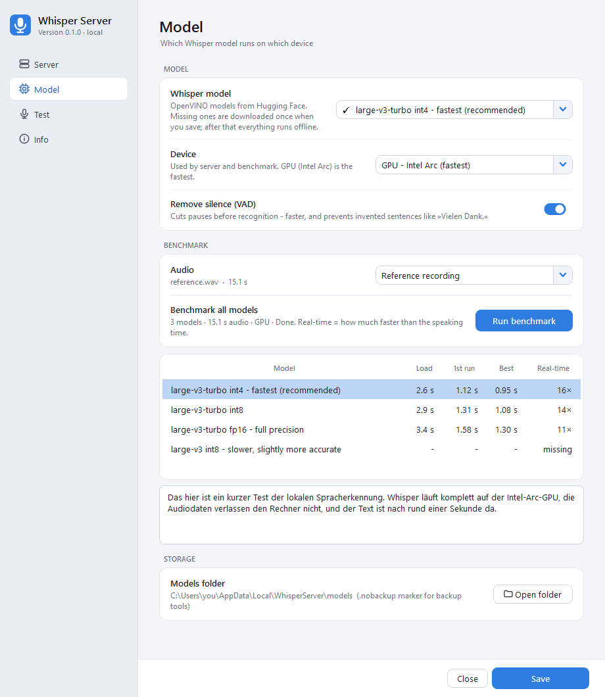
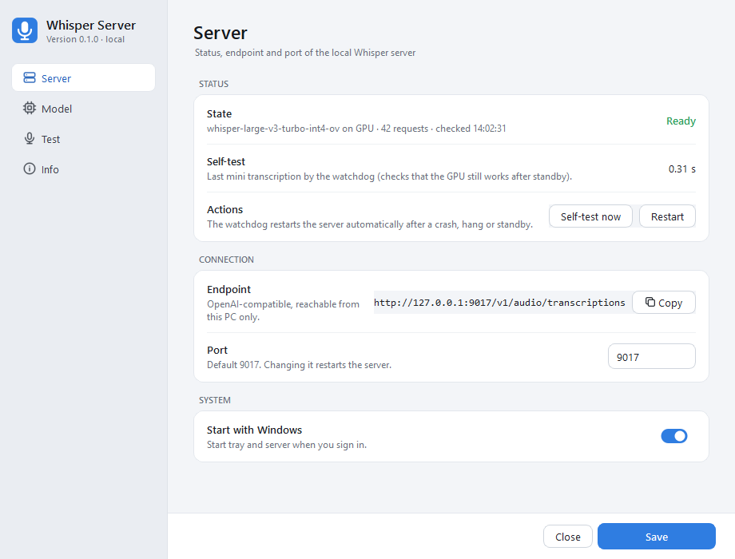
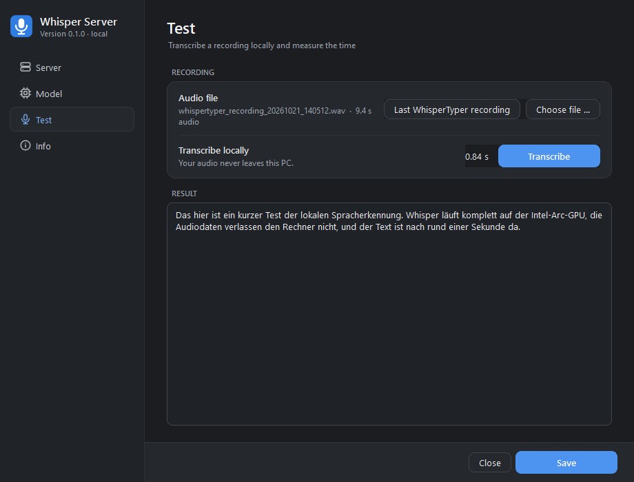
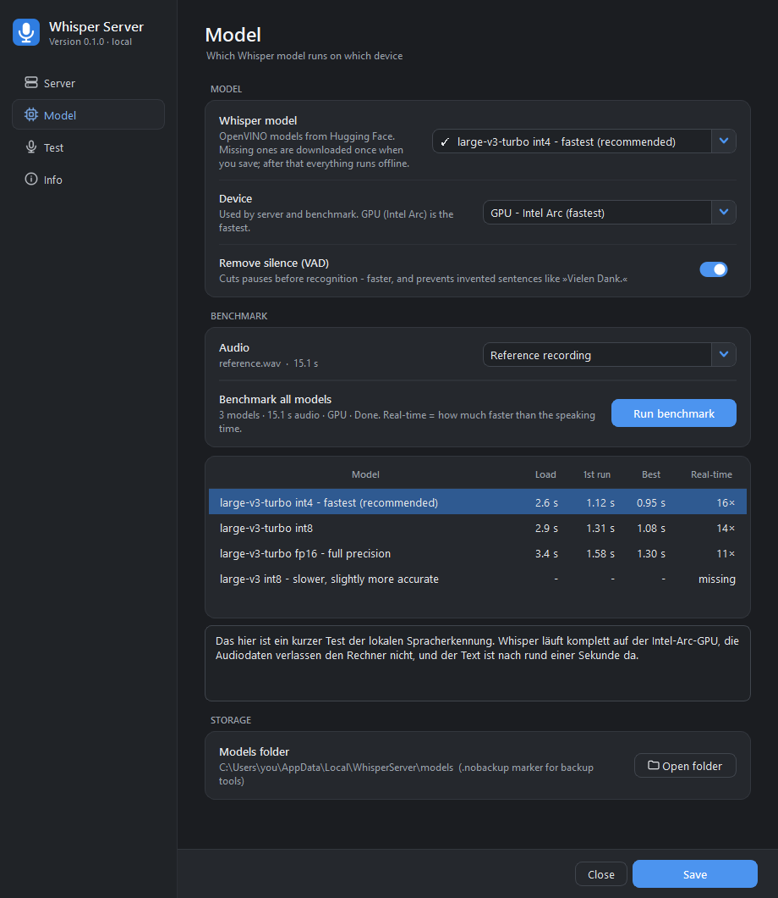
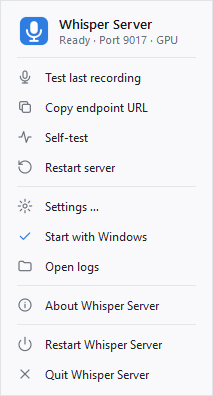
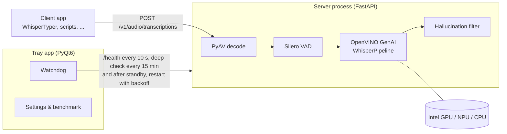

<div align="center">


# Whisper Server

**Private, local speech-to-text for Windows, with an OpenAI-compatible API.**
Whisper large-v3-turbo on OpenVINO (Intel Arc GPU / NPU / CPU). It runs in the tray, a watchdog restarts it when needed, and your audio stays on your PC.

[](https://www.python.org/)
[](#requirements)
[](https://github.com/openvinotoolkit/openvino.genai)
[](https://huggingface.co/OpenVINO)
[](#api)
[](https://fastapi.tiangolo.com/)
[](https://www.riverbankcomputing.com/software/pyqt/)
[](#installation)
[](LICENSE)



</div>

---

## Why

Dictation tools like [WhisperTyper](https://github.com/bjspi/WhisperTyper) and many other apps can talk to an *OpenAI-compatible* transcription endpoint. Cloud endpoints work well, but they send every word you dictate to a third party, and some environments (company laptops, confidential meetings, offline work) do not allow that.

Modern Intel laptops already ship with a capable GPU (Arc iGPU) and an NPU. With **OpenVINO** and the int4 build of **Whisper large-v3-turbo**, a 7-second sentence is transcribed in **under one second** on the iGPU, which is fast enough for live dictation.

Running a model server reliably on a laptop takes more than `uvicorn app:app`, though:

- The GPU can return garbage or hang after **standby / hibernate**.
- A server that crashes overnight should **come back by itself**.
- Whisper **invents sentences** in silence ("Vielen Dank.", "Untertitel im Auftrag des ZDF").
- Users want a **tray icon and a settings window** instead of a terminal.

Whisper Server packages all of that into one app you can install with a single command.

## Features

- 🔒 **100 % local**: the model runs on your machine and the endpoint only listens on `127.0.0.1`.
- ⚡ **Fast on Intel hardware**: OpenVINO GenAI on Arc GPU (default), NPU, CPU or AUTO. Compiled GPU kernels are cached, so a warm model loads in about 2.5 s.
- 🔌 **OpenAI-compatible**: `POST /v1/audio/transcriptions` (plus the Groq-style `/openai/v1/...` path), with `json`, `text` and `verbose_json` responses. Works as a drop-in endpoint for existing clients.
- 🩺 **Self-healing watchdog**: checks `/health` every 10 s and runs a mini transcription every 15 min and right after standby. It restarts the server on crash, hang or GPU loss (backoff 0 → 300 s) and cleans up orphaned servers.
- 🤫 **Silence & hallucination filter**: Silero VAD removes pauses, and typical Whisper hallucinations are dropped.
- 🌍 **German by default**: any Whisper language can be set with `WHISPER_LANGUAGE`.
- 🖥️ **Tray app + modern settings UI** (light/dark): status, endpoint, port, model, device, autostart, a test page and a benchmark.
- 📊 **Built-in benchmark**: times every downloaded model (load, first run, best of 3, real-time factor) on a reference recording, a fresh microphone take or any file.
- 📦 **One-command install & update** via `uv tool` or `pipx`, plus `whisperserver update`.

## Screenshots

<table>
  <tr>
    <td width="50%"><br><sub><b>Server</b>: live status, watchdog self-test, endpoint, port, autostart</sub></td>
    <td width="50%"><br><sub><b>Test</b>: transcribe a recording locally and see the latency (dark theme)</sub></td>
  </tr>
  <tr>
    <td width="50%"><br><sub><b>Model</b>: pick model and device, run the benchmark</sub></td>
    <td width="50%" align="center"><br><sub><b>Tray menu</b>: status at a glance, quick test, copy endpoint</sub></td>
  </tr>
</table>

## Requirements

- Windows 10/11 (x64)
- Python 3.10 – 3.13 (uv can download one for you)
- For GPU mode: an Intel GPU (Arc / Iris Xe / Core Ultra iGPU) with a current driver. NPU and CPU work too, just slower.
- About 0.5 – 1.6 GB of disk space per model (downloaded once from Hugging Face on first start).

## Installation

### With uv (recommended)

```powershell
uv tool install --python 3.12 git+https://github.com/bjspi/whisper-server
whisperserver                 # starts the tray in the background
whisperserver autostart on    # optional: start with Windows
```

### With pipx

```powershell
pipx install git+https://github.com/bjspi/whisper-server
whisperserver
```

pipx needs Python 3.10 – 3.13. If your default Python is newer, add `--python 3.12 --fetch-missing-python`.

### Just try it (no install)

```powershell
uvx --python 3.12 --from git+https://github.com/bjspi/whisper-server whisperserver --foreground
```

`uvx` runs from a temporary environment, so use `uv tool install` if you want autostart.

### From source (for development)

```powershell
git clone https://github.com/bjspi/whisper-server
cd whisper-server
.\install.ps1                 # .venv (Python 3.12 via uv), editable install, autostart, start
```

On the first start the server downloads the selected model (about 0.5 GB for the int4 default). The tray icon turns **green** when it is ready.

## Update

```powershell
whisperserver update
```

This command detects how Whisper Server was installed. It stops the tray and server, updates the package and starts the tray again:

| Installed with | `update` runs |
|---|---|
| `uv tool` | `uv tool upgrade --reinstall whisperserver` |
| `pipx` | `pipx reinstall whisperserver` (with the same Python) |
| git clone | `git pull --ff-only` and `uv pip install -e .` |

You can also update by hand with `whisperserver stop`, followed by `uv tool upgrade --reinstall whisperserver` or `pipx reinstall whisperserver`.

## Uninstall

```powershell
whisperserver uninstall       # stops everything and removes the autostart entry
uv tool uninstall whisperserver   # or: pipx uninstall whisperserver
```

Settings, logs and models stay in `%LOCALAPPDATA%\WhisperServer`. Delete that folder to remove them too.

## Usage

### CLI

| Command | What it does |
|---|---|
| `whisperserver` | Start the tray in the background (single instance) |
| `whisperserver --foreground` | Run the tray in the current console, with logs on stderr |
| `whisperserver-gui` | Start the tray without a console window (e.g. for shortcuts) |
| `whisperserver stop` | Stop tray and server |
| `whisperserver update [--no-restart]` | Update to the latest version |
| `whisperserver autostart on\|off` | Start with Windows (HKCU Run key, no admin needed) |
| `whisperserver uninstall` | Stop and remove autostart |
| `whisperserver version` | Show version and install type |
| `whisperserver --check` | Validate the configuration and print paths |
| `python -m whisperserver.bench [file] [--device GPU]` | Benchmark all downloaded models from the CLI |

### API

```text
POST http://127.0.0.1:9017/v1/audio/transcriptions   multipart: file, [prompt], [response_format]
GET  http://127.0.0.1:9017/v1/models
GET  http://127.0.0.1:9017/health                     ?deep=1 runs a tiny transcription
```

```powershell
curl.exe -F file=@recording.wav http://127.0.0.1:9017/v1/audio/transcriptions
# {"text": "..."}
```

```python
from openai import OpenAI

client = OpenAI(base_url="http://127.0.0.1:9017/v1", api_key="local")
with open("recording.wav", "rb") as f:
    print(client.audio.transcriptions.create(model="whisper-1", file=f).text)
```

The server ignores the API key, `model` and `temperature`; language and model come from the server settings. Any format FFmpeg/PyAV can decode works (`wav`, `mp3`, `m4a`, `ogg`, `flac`, `webm`, ...).

### Connecting clients

In any app with a *custom / OpenAI-compatible* transcription provider, for example [WhisperTyper](https://github.com/bjspi/WhisperTyper):

- **URL**: `http://127.0.0.1:9017/v1/audio/transcriptions` (or `.../openai/v1/audio/transcriptions`)
- **API key**: anything, e.g. `local`
- **Model**: anything

If you use a system proxy, add `127.0.0.1` / `localhost` to its bypass list.

## Configuration

Settings are written by the settings window to `%LOCALAPPDATA%\WhisperServer\.env`. `WHISPER_*` environment variables take precedence.

| Key | Default | Notes |
|---|---|---|
| `WHISPER_PORT` | `9017` | |
| `WHISPER_MODEL` | `OpenVINO/whisper-large-v3-turbo-int4-ov` | Any OpenVINO Whisper repo on Hugging Face, or a local path |
| `WHISPER_DEVICE` | `GPU` | `GPU`, `NPU`, `CPU`, `AUTO` |
| `WHISPER_LANGUAGE` | `de` | Tuned for German; the hallucination filter is German-specific |
| `WHISPER_VAD` | `1` | Silero VAD silence removal |
| `WHISPER_HOST` | `127.0.0.1` | Changing it exposes the server to your network |
| `WHISPER_MODELS_DIR` | `%LOCALAPPDATA%\WhisperServer\models` | A source checkout with a `models\` folder keeps using that one |
| `WHISPER_DATA_DIR` | `%LOCALAPPDATA%\WhisperServer` | Settings, logs, reference recording |
| `WHISPER_LOG_LEVEL` | `INFO` | |

Logs go to `%LOCALAPPDATA%\WhisperServer\logs\` (`tray.log`, `server.log`). The models folder contains a `.nobackup` marker so backup tools can skip it (e.g. `restic --exclude-if-present .nobackup`). Compiled GPU kernels are cached in `models\.ovcache\` (about 0.9 GB). You can delete that folder at any time; the next start just takes a few seconds longer.

## How it works



- **Tray process**: single-instance Qt app with the watchdog thread, tray menu and settings window.
- **Server process** (`python -m whisperserver.server`): loads the model in the background, so `/health` answers immediately with `downloading` → `loading` → `ready`.
- The **benchmark** runs in a separate process, so the live server keeps serving.

## Benchmarks

Intel Core Ultra 7 165H (Arc iGPU), German speech:

| Setup | 26.5 s audio | 7.1 s audio |
|---|---|---|
| **GPU, large-v3-turbo int4 (default)** | **~1.9 s** | **~0.95 s** |
| GPU, large-v3-turbo fp16 | ~1.8 – 2.2 s | ~1.3 s |
| NPU, large-v3-turbo int4 | 3.6 s (7.5 min initial load, unstable) | 2.5 s |
| CPU, faster-whisper int8 (for comparison) | ~6 s | - |

Run your own benchmark under **Settings → Model → Benchmark**.

## Troubleshooting

- **Tray icon is red**: open the settings, check the status, then use *Open logs* to read `server.log`.
- **First start takes long**: the model is downloading (0.5 – 1.6 GB). Behind a corporate proxy, set `HTTPS_PROXY`; the system certificate store is used via `truststore`.
- **GPU errors after standby**: the watchdog detects them and restarts the server automatically. You can also run *Self-test* from the tray menu.
- **Port already in use**: change the port on the *Server* page; the server restarts on the new port.

## License

[MIT](LICENSE)
